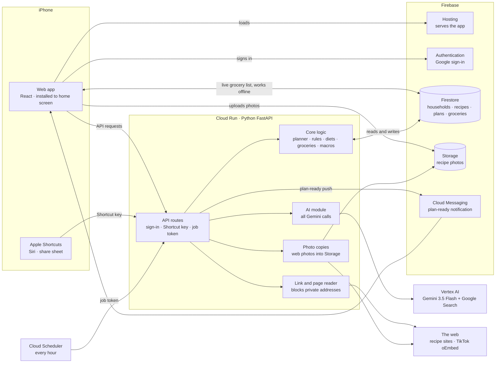
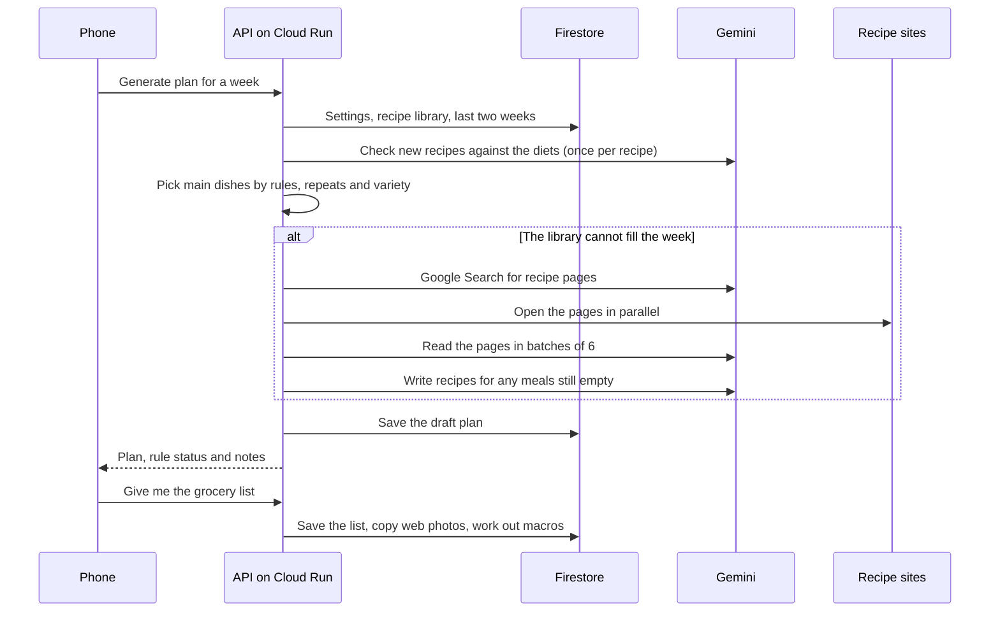

# Architecture

What the app is made of today. GitHub shows these diagrams rendered.

## Components

## Generating a weekly plan

## Where things live

| Part | Code | Runs on |
|---|---|---|
| Screens | `web/src` (React, TypeScript, Tailwind) | Firebase Hosting |
| API routes | `backend/app/api` | Cloud Run |
| Planning, rules, diets, groceries, macros | `backend/app/core` (no database or AI code) | Cloud Run |
| Gemini calls | `backend/app/ai/gemini.py` | Cloud Run, calling Vertex AI |
| Web search and page reading | `backend/app/web_recipes.py`, `backend/app/links.py` | Cloud Run |
| Data | `backend/app/repo/firestore.py`, `firestore.rules`, `storage.rules` | Firestore, Storage |
| Tests and checks | `backend/tests`, `.github/workflows/ci.yml` | GitHub Actions |
