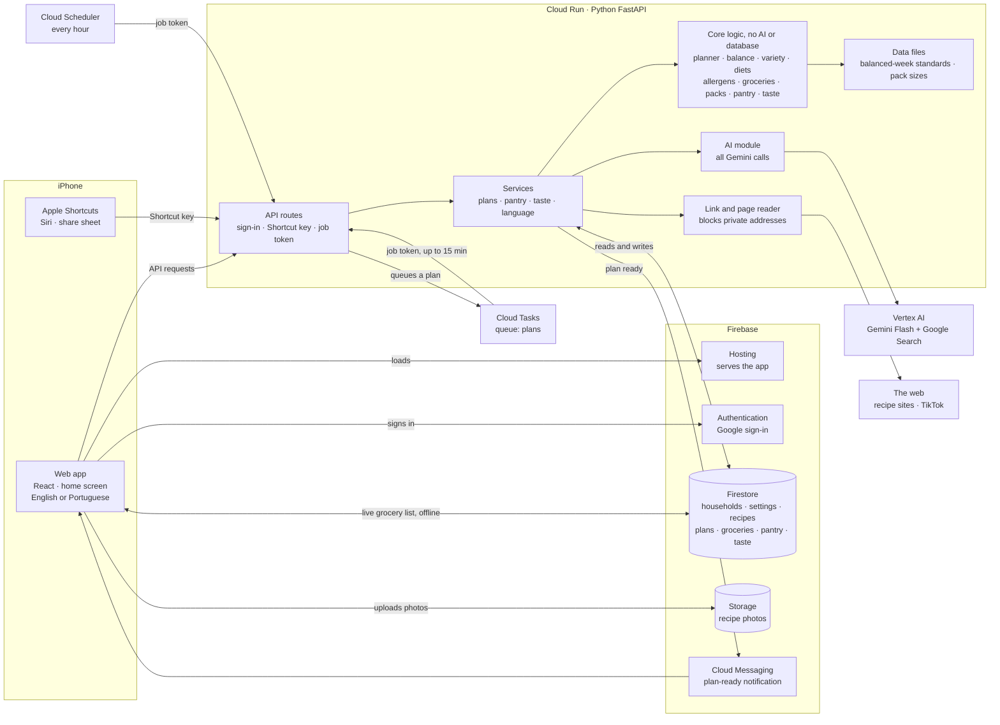
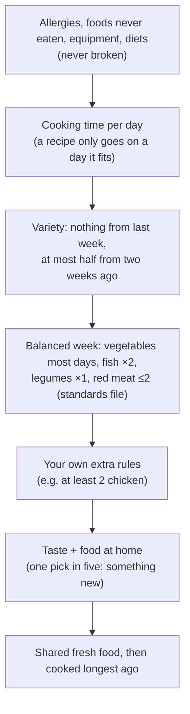
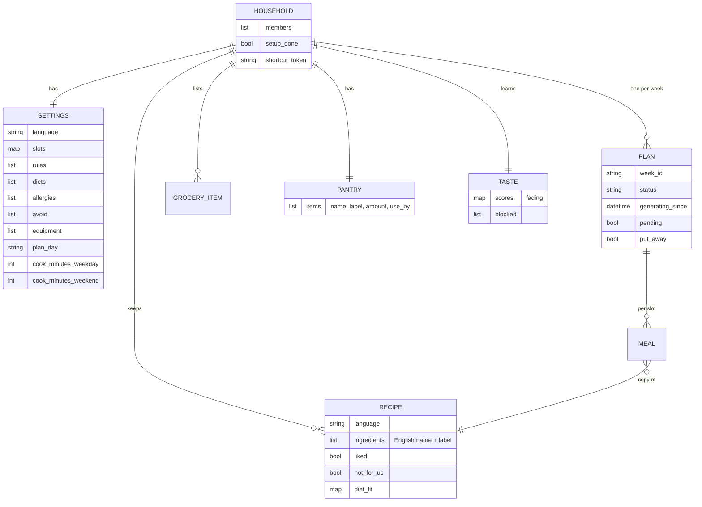

# Architecture

What the app is made of today. GitHub shows these diagrams rendered.

## Components



## Making a weekly plan

Plans are made in the background so no request runs into Firebase Hosting's
one-minute limit.

```mermaid
sequenceDiagram
  participant P as Phone
  participant A as API on Cloud Run
  participant Q as Cloud Tasks
  participant F as Firestore
  participant G as Gemini
  participant W as Recipe sites

  P->>A: Generate plan for a week
  A->>F: Mark the week "generating"
  A->>Q: Queue the job
  A-->>P: The week, marked generating
  loop every 3 seconds
    P->>A: Get the plan
  end
  Q->>A: Run the job (job token)
  A->>F: Settings, library, last two weeks, pantry, taste
  A->>G: Check recipes against diets and allergies (once each)
  A->>A: Pick by rules, variety, cooking time, taste, food at home
  alt The library cannot fill the week
    A->>G: Google Search for recipe pages
    A->>W: Open the pages in parallel
    A->>G: Read the pages; write recipes for any meals still empty
  end
  A->>G: Translate new ideas (Portuguese households)
  A->>F: Save the plan (generating cleared)
  P->>A: Get the plan: done
```

Without a Cloud Tasks queue configured (locally, in tests), the job runs inside the
request instead.

## How the planner decides

Each step only chooses among what the steps above it allow.



Choosing a meal by hand is always free: any recipe can be picked, with warnings
only for allergies, foods never eaten, equipment and diets.

## Data



Ingredient names are always English underneath (allergies, the pantry, packs and
diets match on them); `label` shows them in Portuguese households.

## Where things live

| Part | Code | Runs on |
|---|---|---|
| Screens | `web/src` (React, TypeScript, Tailwind); Portuguese in `web/src/lib/i18n-pt.ts` | Firebase Hosting |
| API routes | `backend/app/api` | Cloud Run |
| Use cases | `backend/app/services.py` | Cloud Run |
| Planning, rules, variety, balance, diets, allergens, groceries, packs, pantry, taste | `backend/app/core` (no database or AI code) | Cloud Run |
| Background plans | `backend/app/tasks.py` | Cloud Run + Cloud Tasks |
| Gemini calls | `backend/app/ai/gemini.py` (`fake.py` for tests and local runs) | Vertex AI |
| Web search and page reading | `backend/app/web_recipes.py`, `backend/app/links.py` | Cloud Run |
| Balanced-week guidance (placeholder) | `backend/app/standards/default.json` | data |
| Pack sizes | `backend/app/data/packs.json` | data |
| Backend's own words in two languages | `backend/app/i18n.py` | Cloud Run |
| Data | `backend/app/repo/firestore.py`, `firestore.rules`, `storage.rules` | Firestore, Storage |
| Tests and checks | `backend/tests`, `.github/workflows/ci.yml` | GitHub Actions |
